# tShop v1 server architecture

> Catalog storage, analytics, release watching, signing, and agent-assisted
> ingest — built on Cloudflare Workers, D1, R2, Pages, and `boat.dev`.

This document is the infrastructure and backend architecture plan deferred by
[01-prd.md](01-prd.md), [02-screens.md](02-screens.md),
[03-hosting-and-bandwidth.md](03-hosting-and-bandwidth.md), and
[04-oppo-research-lessons.md](04-oppo-research-lessons.md). It takes the
download-counter prototype proven in
[prototypes/cloudflare-dl-prototype](../prototypes/cloudflare-dl-prototype) and
specifies the rest of the server side: how the catalog is stored, validated,
signed, and published; how download analytics are recorded and ranked; and how
apps are ingested and maintained day to day.

## Architecture overview

The runtime contract from [02-screens.md](02-screens.md) stays intact: **the
client has no live catalog API.** At runtime, handhelds fetch static, signed
files from Cloudflare Pages and download immutable APKs through a single
completion-counting Worker in front of R2. Everything dynamic—curation,
agent-assisted ingest, release watching, APK validation, signing, and
publishing—happens behind the scenes between Cloudflare D1 and ephemeral
`boat.dev` Linux sandboxes.

```mermaid
flowchart TB
    subgraph Client["Handheld / Web Demo"]
        App["tShop Flutter Client"]
        Browser["External Browser (Stats)"]
    end

    subgraph Edge["Cloudflare Edge (Public Runtime)"]
        Pages["Cloudflare Pages\npointer.json · catalog-<sha>.json\nstats.html · stats.json · WebP art"]
        DlWorker["Download Worker (dl.tshop...)\nFixedLengthStream · Range 206\nCount full 200s only"]
        CdnDegrade["Emergency Degrade Host (cdn.tshop...)\nCached R2 · Uncounted (off by default)"]
    end

    subgraph Control["Cloudflare Control Plane"]
        Access["Cloudflare Access (Zero Trust)"]
        AdminWorker["Admin & Orchestrator Worker\n(admin.tshop...)"]
        KillCron["Hourly Kill-Switch Cron\n(GraphQL -> WAF block)"]
        CatalogD1[("D1: tshop-catalog\n(Authoritative source of truth)")]
        AnalyticsD1[("D1: tshop-analytics\n(Completions only)")]
        ApkR2[("R2: tshop-apks (private)\n<sha256>.apk (N and N-1)")]
        AssetR2[("R2: tshop-assets (private)\nRaw art · WebP archive · D1 backups")]
        Email["Email Alerting\n(Cloudflare Email Service / API)"]
    end

    subgraph Boat["boat.dev Sandboxes (Billed per second, stopped when idle)"]
        WorkerBoat["tshop-worker Snapshot\nUbuntu · aapt2 · apksigner · libvips\nChrome · gh · Adapters · Agent"]
        SignerBoat["tshop-signer Snapshot (Locked Down)\nMinimal Ubuntu · Ed25519 Private Key\nNo browsers · No scrapers · No agents"]
    end

    App -- "Static GET + ETag/304" --> Pages
    App -- "GET /apk/<sha>.apk?r=install|update" --> DlWorker
    App -. "Emergency degrade only" .-> CdnDegrade
    Browser --> Pages

    DlWorker -- "Stream bytes" --> ApkR2
    DlWorker -- "Upsert (sha256, day, intent)" --> AnalyticsD1
    CdnDegrade -. "Cached read" .-> ApkR2

    Access --> AdminWorker
    AdminWorker <--> CatalogD1
    AdminWorker -- "Read counts" --> AnalyticsD1
    AdminWorker <--> AssetR2
    AdminWorker -- "Alert emails" --> Email
    KillCron -- "WAF rule + alert" --> Email

    AdminWorker -- "Dispatch ingest / watch / art jobs" --> WorkerBoat
    WorkerBoat -- "Upload APKs & art" --> ApkR2
    WorkerBoat -- "Upload raw/WebP art" --> AssetR2
    WorkerBoat -- "Job-scoped token callback" --> AdminWorker

    AdminWorker -- "Dispatch publish job" --> SignerBoat
    SignerBoat -- "Verify APKs exist" --> ApkR2
    SignerBoat -- "Read art & write D1 backup" --> AssetR2
    SignerBoat -- "Sign pointer.json & wrangler pages deploy" --> Pages
    SignerBoat -- "Publish receipt callback" --> AdminWorker
```



### Trust boundaries

Four strict isolation boundaries keep a bug or compromise in one layer from
reaching the rest:

1. **Public download Worker has zero catalog access.** `dl.tshop...` holds only
   a read binding to `tshop-apks` and a write binding to `tshop-analytics`. It
   cannot read or mutate `tshop-catalog`, cannot invoke `boat.dev`, and has no
   signing keys.
2. **Untrusted scraping/APK inspection never touches signing keys.**
   `tshop-worker` runs HTML scrapers, `aapt2`, `apksigner`, Chrome, and AI
   ingest agents on untrusted upstream inputs. It never holds the Ed25519
   signing key and never holds direct D1 credentials—it reports results back to
   `admin.tshop...` using a single-use, job-scoped callback token (15-minute
   TTL) that can only update the job it was issued for.
3. **Signing happens in a separate, stripped-down `boat.dev` image.**
   `tshop-signer` contains no browsers, scrapers, or agent harnesses, and uses
   a separate scoped Boat API token so a compromised worker sandbox cannot fork
   or inspect it. Its Ed25519 private key is provided via Boat secrets (or a
   dedicated locked snapshot), and it enforces independent publish invariants
   before signing anything.
4. **Admin UI and API sit behind Cloudflare Access.** Every request to
   `admin.tshop...` (outside signed job callbacks) requires a valid Cloudflare
   Access JWT verified by the Admin Worker.

---

## Core catalog storage (`tshop-catalog` D1)

Cloudflare D1 (`tshop-catalog`) is the authoritative, editable source of truth
for the store. Static `catalog.json` is strictly a compiled, signed output of
`tshop-catalog` joined with `tshop-analytics`.

### Data model

All localizable text columns store a JSON object keyed by BCP-47 language tag
with `"en"` required as the fallback (e.g., `{"en": "..."}`), matching
[02-screens.md](02-screens.md).

#### `apps`

One row per curated catalog entry.

| Column | Type | Notes |
|---|---|---|
| `package_name` | `TEXT PRIMARY KEY` | Android application ID (e.g., `org.dolphinemu.dolphin`). |
| `slug` | `TEXT NOT NULL UNIQUE` | URL-safe identifier (e.g., `dolphin`). |
| `status` | `TEXT NOT NULL` | `draft` \| `published` \| `delisted`. New apps always start `draft`. |
| `rehost_mode` | `TEXT NOT NULL` | `rehost` \| `landing`. Per-app licensing/policy flag from [03-hosting-and-bandwidth.md](03-hosting-and-bandwidth.md). |
| `landing_reason_i18n` | `TEXT` | JSON map; required when `rehost_mode = 'landing'`. |
| `name_i18n` | `TEXT NOT NULL` | Display name. |
| `summary_i18n` | `TEXT NOT NULL` | Concise one-line Browse/Detail summary. |
| `description_i18n` | `TEXT NOT NULL` | Full Detail description (paragraphs). |
| `compat_notes_i18n` | `TEXT` | Optional handheld setup / compatibility notes. |
| `publisher` | `TEXT NOT NULL` | Upstream author or project name. |
| `homepage_url` | `TEXT NOT NULL` | Upstream project URL (distinct from download source). |
| `primary_category` | `TEXT NOT NULL` | Exactly one: `Emulators` \| `Frontends` \| `Games` \| `Utilities`. |
| `search_tags` | `TEXT NOT NULL` | JSON string array; search match material only (resolves [99-spec-critique.md](99-spec-critique.md) §11). |
| `capabilities` | `TEXT NOT NULL` | JSON array of closed-vocabulary capability tags (e.g., `gpu:adreno`). Pipeline rejects unknown tags. |
| `backdrop_colors` | `TEXT NOT NULL` | JSON array of 1–2 hex colors for in-app tile gradient compositing. |
| `backdrop_angle` | `REAL NOT NULL` | Gradient angle in degrees (default `160`). |
| `icon_scale` | `REAL NOT NULL` | Scale factor for in-app [`TshopTile`](../client/lib/src/theme/widgets/tshop_tile.dart) compositing (`>1` crops rounded corners). |
| `seed_rank` | `INTEGER NOT NULL` | Curator-assigned rank for cold-start and Landing Page ordering. |
| `editorial_pin` | `INTEGER` | Optional explicit position override within its category. |
| `source_type` | `TEXT NOT NULL` | `github_release` \| `json_feed` \| `html_links` \| `direct_url` \| `custom` \| `none`. |
| `source_config` | `TEXT NOT NULL` | Typed declarative JSON for the chosen adapter. Never executable code. |
| `license_spdx` | `TEXT NOT NULL` | SPDX identifier or `"Proprietary"` / `"Custom"`. |
| `license_notes` | `TEXT` | Redistribution notes checked at curation time. |
| `approved_release_id` | `INTEGER` | FK → `releases.id`. Currently published release (`NULL` for `draft` or `landing`). |
| `previous_release_id` | `INTEGER` | FK → `releases.id`. N-1 approved release retained in R2 for instant rollback. |
| `created_at` | `TEXT NOT NULL` | ISO-8601 UTC timestamp. |
| `updated_at` | `TEXT NOT NULL` | ISO-8601 UTC timestamp. |

#### `app_certs`

Per-package publisher signing certificate allowlist (resolves
[99-spec-critique.md](99-spec-critique.md) §13 and
[04-oppo-research-lessons.md](04-oppo-research-lessons.md) §5 — a single
expected cert cannot represent legitimate key rotations or dual-signed builds).

| Column | Type | Notes |
|---|---|---|
| `id` | `INTEGER PRIMARY KEY` | |
| `package_name` | `TEXT NOT NULL` | FK → `apps.package_name`. |
| `sha256_fingerprint` | `TEXT NOT NULL` | Lowercase hex SHA-256 of the X.509 signing certificate. |
| `label` | `TEXT NOT NULL` | Human label (e.g., `"Upstream GitHub key"`, `"2026 v3 rotation"`). |
| `active` | `INTEGER NOT NULL` | `1` = accepted for new releases and client verification; `0` = historical/revoked. |
| `added_reason` | `TEXT NOT NULL` | Mandatory justification recorded at ingest or rotation. |
| `added_by` | `TEXT NOT NULL` | Operator identity from Cloudflare Access. |
| `created_at` | `TEXT NOT NULL` | |
| `revoked_at` | `TEXT` | Nullable. |
| `revoked_reason` | `TEXT` | Mandatory when revoked. |

#### `releases`

Retained indefinitely in D1 so historical analytics stay joinable to version
names, `versionCode` regressions/re-tags are detectable, and multi-release
changelogs can be emitted.

| Column | Type | Notes |
|---|---|---|
| `id` | `INTEGER PRIMARY KEY` | |
| `package_name` | `TEXT NOT NULL` | FK → `apps.package_name`. |
| `version_code` | `INTEGER NOT NULL` | Authoritative Android `versionCode` (decides update order). |
| `version_name` | `TEXT NOT NULL` | Display string only. |
| `released_at` | `TEXT NOT NULL` | Upstream release date (ISO-8601 UTC). |
| `changelog_i18n` | `TEXT` | Sanitized plain-text/bullet changelog JSON map. |
| `state` | `TEXT NOT NULL` | `candidate` \| `approved` \| `quarantined` \| `superseded` \| `rejected` \| `rolled_back`. |
| `variants_are_user_choice` | `INTEGER NOT NULL` | `1` when the client should show a variant picker (e.g., Vulkan vs GLES). |
| `validation_report` | `TEXT NOT NULL` | JSON output of all 11 validation gates, manifest lint, permission diff, and 16 KB alignment note. |
| `quarantine_reasons` | `TEXT` | JSON array of failure/flag codes when `state = 'quarantined'`. |
| `promoted_by` | `TEXT` | `"auto"` or operator identity. |
| `superseded_at` | `TEXT` | Timestamp when replaced by a newer approved release. |
| `created_at` | `TEXT NOT NULL` | |

#### `release_variants`

One row per validated APK file belonging to a release. Retained indefinitely in
D1 even after old APK bytes are purged from R2.

| Column | Type | Notes |
|---|---|---|
| `id` | `INTEGER PRIMARY KEY` | |
| `release_id` | `INTEGER NOT NULL` | FK → `releases.id`. |
| `sha256` | `TEXT NOT NULL` | Lowercase hex SHA-256 of the APK bytes; also the join key to `tshop-analytics`. |
| `size_bytes` | `INTEGER NOT NULL` | Exact byte length; verified by `FixedLengthStream` and client free-space checks. |
| `abis` | `TEXT NOT NULL` | JSON array (e.g., `["arm64-v8a"]`). |
| `min_sdk` | `INTEGER NOT NULL` | Extracted by `aapt2`. |
| `target_sdk` | `INTEGER NOT NULL` | Extracted by `aapt2`. |
| `label_i18n` | `TEXT` | Optional human label when `variants_are_user_choice = 1`. |
| `note_i18n` | `TEXT` | Optional short variant explainer. |
| `upstream_url` | `TEXT NOT NULL` | Publisher's direct APK URL for Privacy Mode. |
| `r2_key` | `TEXT NOT NULL` | `<sha256>.apk` in `tshop-apks`. |
| `r2_present` | `INTEGER NOT NULL` | `1` while bytes exist in `tshop-apks`, `0` after GC. |
| `r2_gc_after` | `TEXT` | Nullable UTC timestamp (`superseded_at + 7 days`) after which GC may delete `r2_key`. |

#### `app_assets`

Stores artwork references, source provenance, and rights basis (resolving
[99-spec-critique.md](99-spec-critique.md) §F). Tiles are **not** pre-baked
with gradients on the server: [`TshopTile`](../client/lib/src/theme/widgets/tshop_tile.dart)
and [`MiniTile`](../design/src/tshop/Stats.tsx) composite `icon` + `backdrop` +
`iconScale` live, so editing a tile's backdrop or crop in the Admin UI is
instant and requires no image re-rendering. `boat.dev` only normalizes, strips
EXIF, resizes, and transcodes uploads to WebP.

| Column | Type | Notes |
|---|---|---|
| `id` | `INTEGER PRIMARY KEY` | |
| `package_name` | `TEXT NOT NULL` | FK → `apps.package_name`. |
| `kind` | `TEXT NOT NULL` | `icon` \| `feature` \| `screenshot`. |
| `sort_order` | `INTEGER NOT NULL` | Ordering for screenshots. |
| `raw_r2_key` | `TEXT NOT NULL` | Original source file archived in `tshop-assets/raw/...`. |
| `webp_sha256` | `TEXT NOT NULL` | Content hash of the normalized full WebP (`icon` 512px, `feature` max 1600px, `screenshot` max 1920px). |
| `thumb_webp_sha256` | `TEXT` | Content hash of the 480px WebP thumbnail (screenshots only). |
| `width` | `INTEGER NOT NULL` | Full WebP width in px. |
| `height` | `INTEGER NOT NULL` | Full WebP height in px. |
| `source_url` | `TEXT NOT NULL` | Exact upstream URL where the asset came from (or `"operator-upload"`). |
| `rights_basis` | `TEXT NOT NULL` | e.g., `"GPLv3 project repo"`, `"Official press kit"`, `"Screenshot captured by tShop"`. |
| `created_at` | `TEXT NOT NULL` | |

#### Supporting operational tables

- **`source_state`** (`package_name` PK, `last_checked_at`, `last_success_at`,
  `etag`, `last_modified`, `consecutive_failures`, `last_error`): conditional
  GET state and failure counters for the 6-hour release watcher.
- **`client_releases`** (`id`, `version_code`, `version_name`, `released_at`,
  `changelog_i18n`, `sha256`, `size_bytes`, `min_sdk`, `upstream_url`,
  `r2_key`, `is_current`, `min_supported_version_code`): powers tShop
  self-updates (silent on Android 12+ as self-installer) and `pointer.json`'s
  `minClientVersionCode` floor (resolves
  [99-spec-critique.md](99-spec-critique.md) §21).
- **`announcements`** (`id`, `severity`, `body_i18n`,
  `min_client_version_code`, `max_client_version_code`, `ack_required`,
  `expires_at`, `active`, `created_at`): lightweight optional catalog messages
  (empty until needed; follows the guardrails in
  [04-oppo-research-lessons.md](04-oppo-research-lessons.md)).
- **`jobs`** (`id`, `kind`, `target_package`, `status`, `boat_sandbox_id`,
  `token_hash`, `token_expires_at`, `payload_json`, `result_json`,
  `created_by`, `created_at`, `finished_at`): tracks every `boat.dev` dispatch
  (`ingest`, `watch_batch`, `validate_app`, `process_art`, `repair_adapter`,
  `publish`).
- **`ops_alerts`** (`id`, `severity`, `kind`, `package_name`, `summary`,
  `details_json`, `status`, `emailed_at`, `created_at`, `resolved_at`): Admin
  UI inbox + email deduplication.
- **`audit_log`** (`id`, `actor`, `action`, `target_type`, `target_id`,
  `reason`, `diff_json`, `created_at`): append-only record of every human
  change; `reason` is mandatory for cert rotations, quarantine overrides,
  rollbacks, delistings, and `rehost ↔ landing` changes.
- **`publish_history`** (`id`, `generated_at`, `schema_version`,
  `min_client_version_code`, `key_id`, `catalog_sha256`,
  `pages_deployment_id`, `apk_base_url`, `entry_count`, `trigger`,
  `created_at`): immutable ledger of published catalog snapshots.

### APK retention, rollback, and garbage collection

- **N-1 retention in `tshop-apks`:** When a new release is promoted, the
  previous approved release moves into `apps.previous_release_id` and its
  variants are stamped `r2_gc_after = now + 7 days`. A daily GC job deletes R2
  objects whose `r2_gc_after` has passed **and** that are no longer referenced
  by either `approved_release_id` or `previous_release_id` (marking
  `r2_present = 0` while keeping the D1 row forever).
- **Cost & benefit:** At 50 apps (~80 MB × 1.3 variants), keeping N-1 moves
  peak R2 storage from ~8 GB to ~16 GB (~$0.09/month over the 10 GB free tier),
  eliminates mid-download 404s during publishes, and makes **one-click
  rollback** in the Admin UI instant without re-fetching from upstream.
- **Delisting GC:** Moving an app to `delisted` removes it from the next
  published `catalog.json`, stamps its APK variants for GC after 7 days (or
  immediately for DMCA/security takedowns), and drops its art from the next
  Pages deploy.

---

## Published static storefront & signing

All client-facing catalog, artwork, and stats files are served from
**Cloudflare Pages** (`catalog.tshop...` / `stats.tshop...`), backed by a
durable copy of processed assets in `tshop-assets` R2.

Why Pages instead of a public R2 bucket:
- **Zero Class B request meter:** Even under a cache-busting `?rand=...` flood
  or a misconfigured Cache Rule, static asset requests on Pages cost $0.00.
- **Incremental hash-deduped deploys:** `wrangler pages deploy` hashes every
  file and uploads only changed files. At 50 apps (~500 WebP/JSON files, well
  under Pages' 20,000-file and 25 MB/file limits) and ~1–5 deploys/day, deploys
  finish in seconds.

### Signed `pointer.json` and immutable `catalog-<sha256>.json`

Following [04-oppo-research-lessons.md](04-oppo-research-lessons.md), the
signing boat signs a small `pointer.json` rather than the full catalog body:

```json
{
  "schemaVersion": 1,
  "minClientVersionCode": 100,
  "generatedAt": "2026-10-06T00:05:00Z",
  "keyId": "tshop-2026-01",
  "catalogUrl": "/catalog/catalog-7f8a...c2.json",
  "catalogSha256": "7f8a...c2",
  "catalogSize": 184320,
  "statsUrl": "/stats/index.html",
  "signature": "<base64-ed25519-sig-over-canonical-fields>"
}
```

- **Caching:** `pointer.json` is served with short cache (`max-age=60`,
  `ETag`/`304` on conditional GET). `catalog-<sha256>.json` and all WebP art
  under `/art/<sha256>.webp` are immutable (`max-age=31536000, immutable`).
- **Client verification:** The Flutter client ships a small trust map
  (`keyId -> Ed25519 public key`) so key rotation is a normal client update
  rather than a reinstall. The client verifies `pointer.json`'s signature,
  rejects any `generatedAt` older than the last verified catalog
  (anti-downgrade), checks `minClientVersionCode` (prompting a tShop
  self-update if below floor), and verifies `catalogSha256` before accepting
  `catalog.json`.

### `catalog-<sha256>.json` payload shape

Compiled deterministically from `tshop-catalog` + `tshop-analytics`. The client
**never sorts**—categories and entries appear in their exact rendered order.

- Top-level: `schemaVersion`, `generatedAt`, `apkBaseUrl` (normally
  `https://dl.tshop.../apk`, flippable to `https://cdn.tshop...` during an
  emergency flood), `client` (current tShop self-update release),
  `announcements` (active, non-expired entries), `categories` (ordered list),
  `entries` (ordered per category).
- Per entry: `packageName`, `slug`, `name`, `publisher`, `category`,
  `searchTags`, `summary`, `description`, `compatNotes`, `homepageUrl`,
  `rehostMode`, `landingReason`, `allowedSigningCerts` (active SHA-256 list),
  `capabilities`, `tile: { iconUrl, backdropColors, backdropAngle, iconScale }`,
  `featureUrl`, `screenshots: [{ thumbUrl, fullUrl, width, height }]`,
  `release` (latest approved: `versionCode`, `versionName`, `releasedAt`,
  `variantsAreUserChoice`, `variants: [{ sha256, sizeBytes, abis, minSdk,
  targetSdk, label, note, tshopUrl, upstreamUrl }]`), and `changelogs` (the
  **last 5 approved releases** `[{ versionCode, versionName, releasedAt,
  notes }]` so the client can render "changes since your installed version",
  resolving [99-spec-critique.md](99-spec-critique.md) §17).

### Signing boat (`tshop-signer`) publish flow

Triggered on: (a) daily 00:05 UTC cron (stats refresh + ranking rebuild +
heartbeat + D1 backup), (b) auto-promotion of a clean update, or (c) manual
**Publish** / **Rollback** / **Degrade** click in the Admin UI.

1. Admin Worker prepares a read-only publish bundle (serialized D1 catalog
   state + computed rankings + generated `stats.html`/`stats.json`) and
   dispatches `tshop-signer` with a job-scoped token.
2. `tshop-signer` syncs the Pages build directory against `tshop-assets` R2,
   renders `catalog-<sha256>.json`, and runs **hard publish invariants**:
   - JSON Schema validation passes on the generated catalog.
   - Every referenced APK `sha256` exists in `tshop-apks` R2 (`HEAD` check)
     with matching byte size.
   - Published entry count did not drop by more than 1 (or >10%) compared to
     the last `publish_history` row unless an explicit operator override flag
     is set (prevents empty/truncated publishes).
   - `generatedAt` is strictly greater than the previous published timestamp.
3. Signs `pointer.json` with the Ed25519 private key held exclusively in
   `tshop-signer`.
4. Deploys to Cloudflare Pages (`wrangler pages deploy`, atomic cutover).
5. On the daily scheduled run, exports canonical JSON/SQL snapshots of both
   `tshop-catalog` and `tshop-analytics` into `tshop-assets/backups/YYYY-MM-DD/`.
6. Calls back to the Admin Worker with the `publish_history` receipt and stops.

---

## Analytics, download counting, and ranking

### Scope & PRD alignment

We preserve [01-prd.md](01-prd.md)'s core privacy contract: **only completed
APK downloads from tShop's host are counted**, zero IP addresses or device IDs
are stored in analytics, catalog/artwork/search traffic is never tracked, there
is no private operator-only user analytics view, and Privacy Mode fetches
directly from `upstreamUrl` (never hitting `dl.tshop...`).

**One intentional v1 addition to the PRD's stored fields:** each download
request carries an explicit `intent` query parameter:

```
GET /apk/<sha256>.apk?r=install
GET /apk/<sha256>.apk?r=update
```

Missing or unrecognized values map to `unknown` (so direct fetches never break
or inflate `install`). Splitting `install` from `update` adds zero user
identity, stays 100% visible on the public stats page, and solves
[99-spec-critique.md](99-spec-critique.md) §6: an emulator that releases four
times a month no longer outranks a rock-solid app purely on update churn.

User-reported broken installs are **not** telemetry: Detail / failed queue
items provide an explicit external link to a pre-filled issue form (package +
version) if a user chooses to report a problem.

### Analytics storage (`tshop-analytics` D1)

Isolated in its own D1 database so `dl.tshop...` never touches `tshop-catalog`:

```sql
CREATE TABLE IF NOT EXISTS completions (
  sha256  TEXT NOT NULL,
  utc_day TEXT NOT NULL, -- YYYY-MM-DD
  intent  TEXT NOT NULL CHECK (intent IN ('install', 'update', 'unknown')),
  n       INTEGER NOT NULL DEFAULT 0,
  PRIMARY KEY (sha256, utc_day, intent)
);
```

- **Write path:** Direct upsert inside `ctx.waitUntil(pipe.then(...))` only
  when a full `200` `FixedLengthStream` transfer completes cleanly (the exact
  path benchmarked at 0.9 ms P50 / 2.2 ms P99 CPU in
  [prototypes/cloudflare-dl-prototype](../prototypes/cloudflare-dl-prototype)).
  `HEAD` and single `Range` `206` resumes are served uncounted; multi-range
  requests return `400`.
- **Retention:** Kept indefinitely in D1 (no 90-day Analytics Engine cliff).
  Because `tshop-catalog` retains `release_variants` and `releases` rows
  forever, `completions.sha256` always joins back to `(package_name,
  version_code, variant)` at publish time.
- **Scale-out path:** Free up to 50M writes/month (~1.6M completed downloads/day).
  If future Update All spikes ever cause single-writer D1 contention, a per-day
  Durable Object write-buffer flushing batched SQL every ~15 seconds drops in
  in front of `tshop-analytics` with zero schema change.

### Public stats page & k-anonymity

Generated statically once per day by the publish job onto Cloudflare Pages
(`/stats/index.html` and `/stats/stats.json`):

- Displays **rolling 7-day** and **all-time** totals per app (matching
  [Stats.tsx](../design/src/tshop/Stats.tsx)), broken out into `installs` and
  `updates`, plus **weekly** per-version/variant historical series in
  `stats.json`.
- **Low-volume suppression (k-anonymity):** Any individual published bucket
  with `1 <= n < 5` is displayed/emitted as `"<5"` (never an exact small daily
  integer) so long-tail entries cannot be read as near-real-time user activity
  ([99-spec-critique.md](99-spec-critique.md) §7).
- Publishes the exact "What tShop knows about you" policy, notes that
  "completed" means piped to Cloudflare's edge, states that counts are
  approximate and exclude Landing Page + Privacy Mode downloads, and documents
  the ranking formula below.

### Popularity ranking formula

Computed daily during publish from `tshop-analytics` joined to `tshop-catalog`:

1. **Daily anomaly clamp:** For each app, if a day's count exceeds `max(50, 5 ×
   trailing_14d_median)`, clamp the value used for ranking to that ceiling and
   emit a warning alert in `ops_alerts` (blunts scripted counter poisoning
   without hiding raw totals).
2. **Weighted daily demand:** `d(t) = installs(t) + 0.25 × updates(t)` (unknown
   intent excluded from ranking).
3. **7-day half-life EWMA:** Smooth `d(t)` with decay factor `α ≈ 0.094`
   (adopted from [04-oppo-research-lessons.md](04-oppo-research-lessons.md)).
4. **Cold-start & Landing Page handling:**
   - Rehosted apps that have been published fewer than 14 days **or** have fewer
     than 25 cumulative installs use their curator `seed_rank` (blended into
     the category order) instead of sinking to the bottom with `0`.
   - **Landing Page** apps (which never generate tShop downloads) are
     positioned permanently by their curator `seed_rank` (or `editorial_pin`).
   - Category frame order on Browse follows aggregate 7-day install demand
     across each category's entries, with a curator tie-breaker order.

---

## Release watcher & validation pipeline (`tshop-worker`)

A Cloudflare Cron Trigger invokes the Admin/Orchestrator Worker every **6
hours**, which dispatches a `watch_batch` job to a forked `tshop-worker`
sandbox on `boat.dev`.

### Declarative source adapters

Each app's `source_type` + `source_config` JSON in D1 selects one of a closed
set of deterministic adapters (no AI runs during scheduled checks, and no
executable code is ever stored in D1):

| `source_type` | Covers | `source_config` highlights |
|---|---|---|
| `github_release` | Standard GitHub releases & separate builds repos (e.g., Vita3K) | `repo`, `includePrereleases` (default `false`), per-variant `assetRegex` |
| `json_feed` | Structured JSON feeds (e.g., Eden `release.json`) | `url`, version/asset JSON paths, `assetRegex` |
| `html_links` | 1- or 2-hop HTML pages & directory listings (Dolphin, PPSSPP, ScummVM, Play!, RetroArch) | `hops: [{ url, linkRegex }]`, `versionRegex`, `versionRewrite` |
| `direct_url` | Pinned stable download URLs | `url`, variant metadata |
| `custom` | Escape hatch for unusual upstreams | `handlerName` referencing a code-reviewed TS module baked into `tshop-worker` |
| `none` | Landing Page entries | Never polled for APKs |

Polling hygiene (from [04-oppo-research-lessons.md](04-oppo-research-lessons.md)):
- Honest `User-Agent` (`tShop-Catalog-Watcher/1.0 (+https://tshop...)`); never
  spoof a browser UA.
- Conditional GETs using stored `etag` / `last_modified` in `source_state`.
- Retry once on HTTP `429` or `403` with `x-ratelimit-remaining: 0`; never
  retry bare `403`.
- Record consecutive failures in `source_state`; after **3 consecutive
  failures** (~18 hours), open an `ops_alerts` entry and email the operator
  (auto-resolving on the next clean check).

### Ordered validation gates

Whenever an adapter discovers a candidate URL/version that differs from the
currently approved release, `tshop-worker` downloads the APK once and runs the
11 ordered gates from
[04-oppo-research-lessons.md](04-oppo-research-lessons.md):

1. **Transfer integrity:** Download succeeds; byte count matches upstream
   `Content-Length` (when sent); record exact `size_bytes` and `sha256`.
2. **Container check:** Genuine `.apk` ZIP with `resources.arsc` present;
   explicitly reject `.xapk`, `.apks`, `.apkm`, or multi-package archives.
3. **Package identity:** `aapt2` package name strictly matches
   `apps.package_name`.
4. **Version progression:** `versionCode` present and compared against the
   approved release:
   - **Higher:** continue.
   - **Equal, same `sha256`:** no-op (already published).
   - **Equal, different `sha256`:** quarantine (probable upstream re-tag).
   - **Lower:** quarantine (regression / rollback needs human review).
5. **Signature verification:** Verified with a pinned `apksigner` (≥ 30, never
   33.x); v2 or newer signature scheme required; signing cert SHA-256 is in
   `app_certs` (`active = 1`); APK Signing Block contains only known block IDs
   (catches Play Frosting re-wraps).
6. **Manifest lint & permission diff:** Hard-reject `debuggable`, `testOnly`,
   and `usesCleartextTraffic`; flag `VpnService`, `InputMethod`,
   `AccessibilityService`, and newly added dangerous permissions compared to
   the currently approved release.
7. **Target SDK floor:** `targetSdk >= 24` (installable on current Android;
   quarantine if below floor without an explicit exception).
8. **ABI check:** At least one variant supports `arm64-v8a` (refuse
   `armeabi-v7a`-only candidates in v1).
9. **16 KB page-size lint:** Record `16 KB` vs `4 KB` native library alignment
   as an informational note in `validation_report` (non-blocking in v1).
10. **Asset match completeness:** Every configured variant slot resolves
    unambiguously.
11. **Metadata sanitization:** Strip HTML/scripts from upstream changelogs and
    enforce length bounds; never execute VCS or repo scripts.

### Auto-promote vs. quarantine

- **Clean update to a `published` app:** All hard gates pass **and** no new
  sensitive permissions/services were flagged → `tshop-worker` uploads
  `<sha256>.apk` to `tshop-apks`, posts the report back to `admin.tshop...`,
  the Admin Worker marks the release `approved` (`promoted_by = 'auto'`), shifts
  the old release to `previous_release_id` (7-day GC grace), and dispatches
  `tshop-signer` to republish.
- **Any failed gate or flagged permission diff:** Upload nothing to public
  paths (keep candidate diagnostics only), insert the release as `quarantined`
  with the full `validation_report`, leave `approved_release_id` untouched so
  clients keep receiving the **last known-good release**, open an `ops_alerts`
  entry, and send an alert email.
- **New (`draft`) apps:** Never auto-promote; always require human approval in
  the Admin UI.

---

## Admin UI & agent-assisted ingest

The Admin Web App (`admin.tshop...`) is served by the Admin Worker behind
Cloudflare Access and reuses the React/TypeScript storefront components from
[design/src/tshop/](../design/src/tshop/) (`Tile`, `Detail`, `Shelf`) for
live, pixel-accurate curation previews.

### Adding a new app (agent-assisted ingest)

1. **Submit URL:** Operator pastes an upstream URL (GitHub repo, project
   website, or Obtainium `obtainium://` link) plus an optional hint (e.g.,
   `"landing page"` or `"stable arm64 only"`) into **New App** in the Admin UI.
2. **Create draft & dispatch `boat.dev`:** Admin Worker inserts a `draft` row
   and a `jobs` row (`kind = 'ingest'`), then forks a `tshop-worker` sandbox on
   `boat.dev` with a 15-minute job-scoped callback token.
3. **Hybrid agent + deterministic run inside `tshop-worker`:**
   - **AI agent (editorial & discovery):** Inspects the repo/site/press kit
     with `gh` and headless Chrome; checks the license and proposes `rehost` vs
     `landing`; identifies the download source and proposes `source_type` +
     `source_config`; drafts `name`, `summary`, `description`, `compat_notes`,
     `primary_category`, `search_tags`, and `capabilities`; locates candidate
     official icons, feature banners, and screenshots (recording exact
     `source_url` and `rights_basis` for every image); suggests initial
     `backdrop_colors`, `backdrop_angle`, and `icon_scale`.
   - **Deterministic toolchain (security-critical facts):** Runs the proposed
     adapter to fetch the latest APK and executes `aapt2`, `apksigner`, and the
     11 validation gates. `package_name`, `app_certs` fingerprints, `versionCode`,
     `abis`, `min_sdk`, `target_sdk`, `size_bytes`, and `sha256` are **always**
     extracted deterministically—never generated by the LLM.
   - **Image normalization:** `libvips` strips EXIF, validates dimensions,
     generates WebP icon/feature/screenshot `thumb` + `full` pairs, and uploads
     raw + processed files to `tshop-assets` R2.
4. **Draft review & live preview:** The sandbox posts the drafted payload back
   to `admin.tshop...` and stops. In the Admin UI, the operator inspects:
   - Live **Browse Tile** and **App Detail** previews with sliders/pickers for
     `backdrop_colors`, `backdrop_angle`, and `icon_scale` (zero server round
     trip).
   - Extracted signing cert fingerprint, license determination, and validation
     report.
   - Drag/reorder/replace screenshots or upload custom art (which dispatches a
     short `process_art` job for WebP transcoding).
5. **Approve & publish:** Operator clicks **Approve & Publish** (recording an
   `audit_log` entry). For `rehost` apps, the validated APK is already staged
   in `tshop-apks`; the Admin Worker flips `status = 'published'` and
   dispatches `tshop-signer`.
6. **Batch seeding:** The exact same `ingest` job accepts a list of candidate
   URLs to populate 30–50 initial `draft` entries in parallel for human review.

### Day-2 admin workflows

- **Quarantine inbox:** Lists every quarantined release with its 11-gate diff
  (e.g., new permissions, cert change, `versionCode` regression). Actions:
  *Reject*, *Approve Release*, or *Approve & Add Signing Cert* (requires a
  written `reason` stored in both `app_certs` and `audit_log`).
- **Adapter health & "Repair with Agent":** Lists apps with failing watchers
  and their last HTTP/regex error. Clicking **Repair with Agent** dispatches a
  `boat.dev` agent to inspect the changed upstream HTML/JSON page and propose a
  `source_config` diff—which the operator tests and approves before saving.
- **One-click rollback:** Swaps `approved_release_id` back to
  `previous_release_id` (mandatory audit reason) and dispatches `tshop-signer`.
- **Policy & lifecycle controls:** Flip `rehost ↔ landing` (with explainer
  text), adjust `seed_rank` / `editorial_pin`, delist an app (triggers GC),
  manage tShop `client_releases` & `minClientVersionCode`, and publish optional
  `announcements`.

---

## Operations, alerting, abuse protection, and backups

### Alerting (Admin Inbox + email)

Every actionable failure writes a row to `ops_alerts` and sends an email via
Cloudflare Email Service (or transactional email API from the Admin Worker),
deduplicated per open alert:

- **Critical (immediate email):** Watcher heartbeat missed (>18 hours since
  last successful `watch_batch`), hourly `/apk/*` kill switch triggered,
  `tshop-signer` publish failure or invariant violation.
- **Warning (immediate or daily digest):** Release quarantined (cert mismatch,
  new sensitive permissions, regression), adapter failed 3× consecutively,
  daily download anomaly clamp fired.

### Edge abuse protection, kill switch, and graceful degrade

Carrying forward [03-hosting-and-bandwidth.md](03-hosting-and-bandwidth.md)
into the Worker topology:

- **Unbilled free-plan edge rules:** Rate limit on `dl.tshop.../apk/*`
  (~20 req / 10 s / IP, honoring `CF-Connecting-IP`), WAF custom rule dropping
  `/apk/*` requests missing the tShop client `User-Agent`, `r2.dev` disabled,
  no public domain on `tshop-apks` unless degraded.
- **Automated kill switch:** An hourly Worker Cron queries Cloudflare's GraphQL
  analytics API for `/apk/*` request volume; if requests exceed a configured
  ceiling, it activates a WAF block rule on `/apk/*` (stopping paid Worker +
  Class B invocations within minutes) and emails a critical alert.
- **Graceful-degrade lever in Admin UI:** One toggle switches the catalog's
  `apkBaseUrl` from `https://dl.tshop.../apk` to a cache-fronted, uncounted
  hostname (`https://cdn.tshop...`, backed by `tshop-apks` with a Cache Rule
  ignoring query strings) and dispatches `tshop-signer`. Under a sustained
  flood, blocking `dl.tshop...` while pointing clients at `cdn.tshop...` keeps
  installs working at ~$0 while only pausing download counts.

### Backups & disaster recovery

No external VPS is required in v1. Recovery lives inside Cloudflare with clean
exportability:

- **D1 Time Travel:** Enabled on both `tshop-catalog` and `tshop-analytics`
  (30-day point-in-time recovery on Workers Paid).
- **Daily canonical snapshots:** The daily `tshop-signer` run exports JSON +
  SQL dumps of both D1 databases to `tshop-assets/backups/YYYY-MM-DD/`
  (retaining e.g. 90 daily + monthly snapshots).
- **Stateless runtime recovery:** Pages deployments, processed WebP art, and
  `catalog.json` are completely reproducible from `tshop-catalog` +
  `tshop-assets` R2. If off-Cloudflare exit insurance is ever wanted later, a
  periodic `rclone`/`rsync` pull of `tshop-assets/backups/` and `tshop-apks`
  gives a complete cold spare without changing the architecture.

---

## Spec deltas to reconcile

Decisions made in this plan refine a few details in earlier specs that should
be updated when those documents are edited:

1. **[01-prd.md](01-prd.md) ("What is stored"):** Add `intent`
   (`install` | `update` | `unknown`) to the daily completed-download row, note
   the `<5` low-volume suppression on the public stats page, and add tShop
   self-update to v1 scope.
2. **[02-screens.md](02-screens.md) ("Catalog entry fields"):** Replace single
   "expected signing identity" with `allowedSigningCerts[]`, replace single
   latest changelog with the last 5 release changelogs, add `rehostMode` /
   `landingReason`, add structured `tile` compositing fields (`backdropColors`,
   `backdropAngle`, `iconScale`), and add the top-level `client` self-update
   block.
3. **[03-hosting-and-bandwidth.md](03-hosting-and-bandwidth.md) ("Recommended
   v1 path"):** Replace the €4–6 Hetzner CX pipeline/backup box with `boat.dev`
   ephemeral sandboxes (separate `tshop-worker` and `tshop-signer` snapshots)
   and Cloudflare-native D1 Time Travel + R2 daily snapshots; clarify N-1 APK
   retention (~$0.09/mo) for zero-404 deploys and instant rollback.
